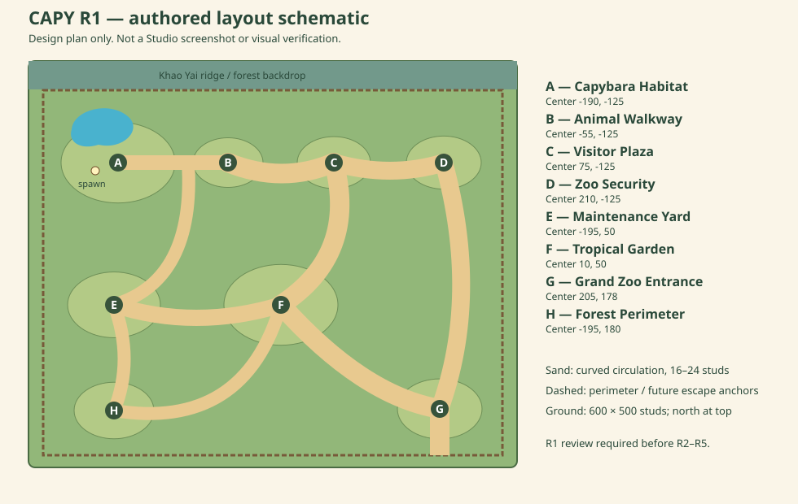

# CAPY-The-Great-Escape
CAPY-The-Great-Escape

## CAPY-M01A FOUNDATION — R1 reconstruction

**CAPY ตัวตึง: The Great Escape** is a planned cartoon story/open-world adventure
set in a fictional tropical wildlife park inspired by Khao Yai, Thailand.

R1 replaces the original 420 × 360 blockout with a **600 × 500 stud master layout**:
eight connected zones, curved roads, a lobed habitat pond, low landscaped terraces,
pitched terracotta landmark roofs, mixed tropical vegetation and mountain scenery.
This is a static world foundation. R1 is not the complete M01A-R project or a
playable escape mission. R2–R5 must wait for R1 review.

### Install immediately in Roblox Studio (no Rojo or Play Mode)

1. Open a place in Roblox Studio on Windows or macOS. Stop Play/Run so you are in
   **Edit Mode**, then open **View → Command Bar**.
2. Open [studio/InstallZoo.command.luau](studio/InstallZoo.command.luau) on GitHub,
   use **Raw**, and copy the **entire file**. Paste it into the Command Bar and execute.
3. The complete generated `Workspace/CapyWorld` appears in Edit Mode. Inspect it
   in Explorer and use Studio's frame-selection action to locate it if needed.
4. Save the place. No plugins, HTTP access, external assets or runtime scripts are
   required for the installed static environment to remain visible after saving.
5. Before a separate Play test, manually remove or disable any unrelated default
   SpawnLocation if you want the avatar to use the habitat's `CapySpawn`. The
   installer deliberately preserves unrelated Workspace content, including spawns.

The installer is deterministic and replaces only a CAPY-owned `CapyWorld`. It
accepts the prior M01A generator's ownership tags for upgrades. An unowned model
with the same name causes a clear error and is preserved; rename/move that model
manually if you want to install. Shared `Workspace.Terrain`, Lighting, existing
services, and unrelated models are not modified. New geometry is built detached
before the previous owned world is replaced.

### Modular development with Rojo

Install [Rojo 7.7.1](https://github.com/rojo-rbx/rojo/releases/tag/v7.7.1) on `PATH`
and its matching Studio plugin. From the repository root:

```sh
rojo serve default.project.json
```

Connect/sync the plugin in a new Baseplate, then press Play. The server bootstrap
builds the same world. Restart `rojo serve` for each development session. No secrets,
package dependencies, DataStore access or other services are needed. Generated
`CapyWorld` ownership tags allow the bootstrap to rebuild a saved installer world.

To build a place file instead:

```sh
mkdir -p build
rojo build default.project.json -o build/CAPY-M01A-R1.rbxlx
```

`build/` is ignored by Git. The one-paste installer is outside the Rojo source
mapping and does not run as a second server script.

### Regenerate and validate

Install Python 3.10+ and the `luau` / `luau-compile` binaries from
[Luau 0.743](https://github.com/luau-lang/luau/releases/tag/0.743) on `PATH`, as
well as Rojo. From the repository root:

```sh
python3 tools/generate_installer.py
python3 tools/generate_layout_diagram.py
python3 tests/check_world.py
```

Commit the regenerated installer whenever its source modules change. The check
runner rejects stale installer/diagram outputs, verifies actual Rojo mapping,
compiles production scripts and the installer, and executes the real builder in
a mocked Roblox data model. It checks bounds, the zone graph and physical route
junctions, sampled 12-stud central walking corridors, slope, spawn clearance,
fence/gate alignment, markers, ownership safety and repeatable builds. It also
runs the installer without the synced source modules and compares its geometry
with the modular build.

These checks do **not** perform Roblox-aware type checking, rendering, engine
physics, avatar movement, network testing or performance measurement.

### Layout and review



- [Zone layout, route widths and terrain plan](docs/R1_LAYOUT.md)
- [R2 asset placement plan — future work](docs/R2_ASSET_PLAN.md)
- [Architecture and installer generation](docs/ARCHITECTURE.md)
- [Automated results and limitations](docs/R1_VALIDATION.md)
- [Studio test procedure](docs/TEST_PLAN.md)

### Current limitations

**Roblox Studio Playtest: NOT RUN.** No Studio screenshots have been captured.
The schematic above describes authored placement; it is not visual verification.
Studio must verify the intended composition, roof orientation, signage, actual
collisions, spawn behavior and frame rate before visual acceptance.

The habitat visitor gate is open for layout inspection. The three perimeter
escape-route anchors remain closed. Water is a shallow decorative surface over
solid ground, not swimmable Terrain water. Checkpoints are visual markers only.
Buildings are R1 architectural anchors with R2 detail reservations. Guard AI,
escape puzzles, rewards, saving and the capybara controller are not implemented.
The capy sculpture is decorative, not an NPC or playable character.
