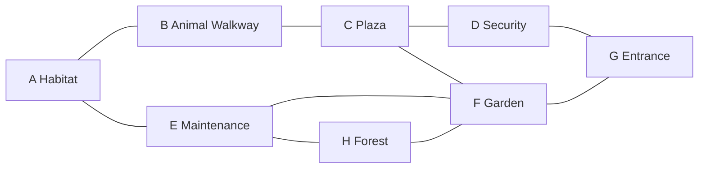

# R1 master layout and terrain

Status: authored R1 foundation; visual acceptance and Studio playtest **NOT RUN**.
See [the schematic](R1_LAYOUT.svg); it is not a Studio capture.

The ground spans X = −300…300, Z = −250…250 (600 × 500 studs). The fenced
visitor area spans X = −282…282, Z = −214…235, leaving a north mountain/forest
scenery strip. All generated geometry, including the backdrop, stays within the
600 × 500 footprint. Y=0 is the base ground surface. Roads undulate gently around
Y=0.6…1.0 with solid gravel roadbeds reaching the ground. Low meadow/berm tiers
have 0.2-stud rises. The terrain is owned model geometry, not shared voxel Terrain.

| Zone | Center X,Z | R1 landmark / composition | Reserved R2 footprint center |
|---|---|---|---|
| A — Capybara Habitat | −190, −125 | Angled timber enclosure, shelter, capy sculpture, kidney pond | −246, −79 |
| B — Animal Walkway | −55, −125 | Shaded wildlife pavilion | −59, −163 |
| C — Visitor Plaza | 75, −125 | Rounded stone paving, lotus fountain, visitor kiosk | 107, −166 |
| D — Zoo Security | 210, −125 | Pitched-roof ranger station, cream infill, open front | 215, −166 |
| E — Maintenance Yard | −195, 50 | Service shed, cobbled apron, supplies outside the path | −225, 14 |
| F — Tropical Garden | 10, 50 | Garden sala and petal beds offset from circulation | 63, 48 |
| G — Grand Zoo Entrance | 205, 178 | Tall gateway, sign, ticket pavilion and promenade | 162, 200 |
| H — Forest Perimeter | −195, 180 | Forest lookout, mixed trees and loop trail | −235, 177 |

## Circulation

Quadratic Bezier strips with rounded joints replace rigid rectangular roads.
B–C, C–F and F–G are 24 studs wide; C–D and D–G are 22; E–F is 20; A–B is 18;
A–E, E–H and H–F are 16. The entrance promenade is 24 studs wide. Automated
sampling reserves a minimum 12-stud central walking corridor; these are geometric
checks, not a pathfinding/physics guarantee. A–E begins at the A–B junction outside
the habitat gate to avoid cutting through the enclosure's south fence.

The habitat entry is open, with 23.8 studs between the gate posts. The clear spawn
at (−218, 0.5, −115) sits inside the habitat on a grounded pad with a short trail.
CP01 is beside the spawn, CP02 marks the plaza and CP03 marks the entrance.
Checkpoints do not update progress or saves. The 12-stud-height outer fence has
aligned, closed scenic anchors for MAIN_GATE, MAINTENANCE_TUNNEL and FENCE_ESCAPE.
These are future route reservations, not functioning escape mechanics.

## Landscape and art decisions

Warm sandstone paths, grass terraces, slate rocks, dark timber and terracotta
roofs set the palette. Buildings use posts, decks, pitched layered wedge roofs,
eaves and raised ridge ornaments rather than solid box placeholders. They are
recognizable architectural anchors, with detailed R2 props and collision polish
still reserved. Double-sided signs can be read from either approach.

The shallow pond uses three overlapping elliptical water/shore lobes and varied
shoreline rocks/reeds; it does not simulate swimming. Low berms and offset meadow
patches break up the grass plane. Fan palms, layered rain trees and bamboo groups
use distinct silhouettes. Placement excludes route corridors, reservation pads,
the curated habitat, plaza and entrance. North ridges and a forest strip frame the
park. No imported asset IDs, HTTP downloads or Lighting overrides are required.

## Review gate

Before R2, inspect the full route loop, eight compositions, pond outline, mountain
silhouette, roof slopes, materials, signs and avatars in Studio. Capture real
Studio screenshots only after installation, label them as Edit/Play captures,
and do not present this plan or headless tests as visual approval.
